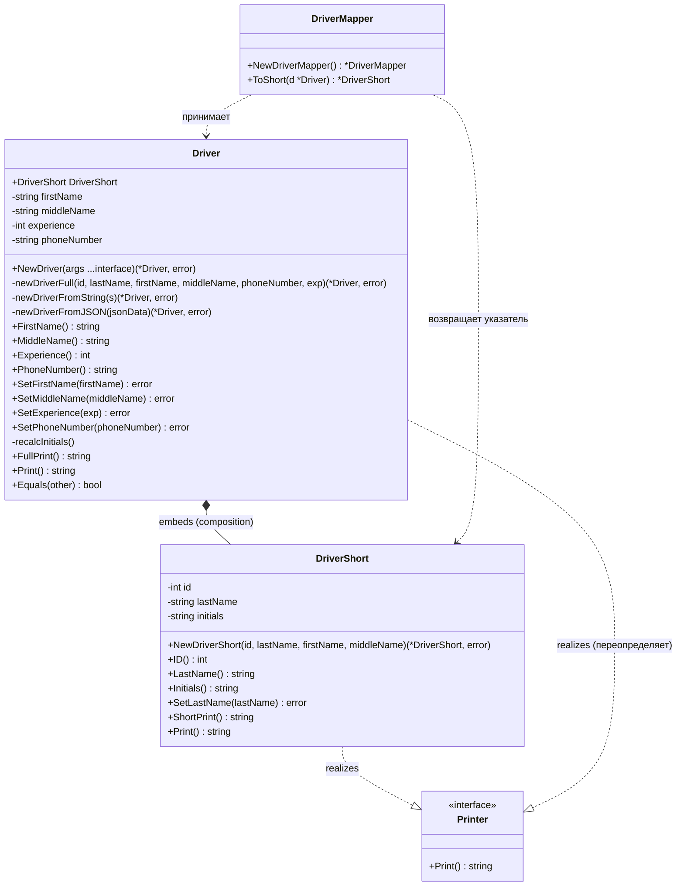

`DriverMapper.ToShort(d)` возвращает `&d.DriverShort` — указатель на встроенную
краткую модель, а не копию. Поэтому изменение имени или отчества через сеттеры
`Driver` обновляет инициалы и в ранее полученном `DriverShort`.

`DriverShort` встроен в `Driver` как экспортируемое поле без отдельного имени
`short`. Преобразование `ToShort` принадлежит мапперу, а не `Driver`.

Функции создания (`NewDriver`, `NewDriverShort`, `NewDriverMapper` и
`newDriver…`) показаны рядом с соответствующими типами для удобства чтения;
в Go это функции пакета `driver`, а не методы структур.
