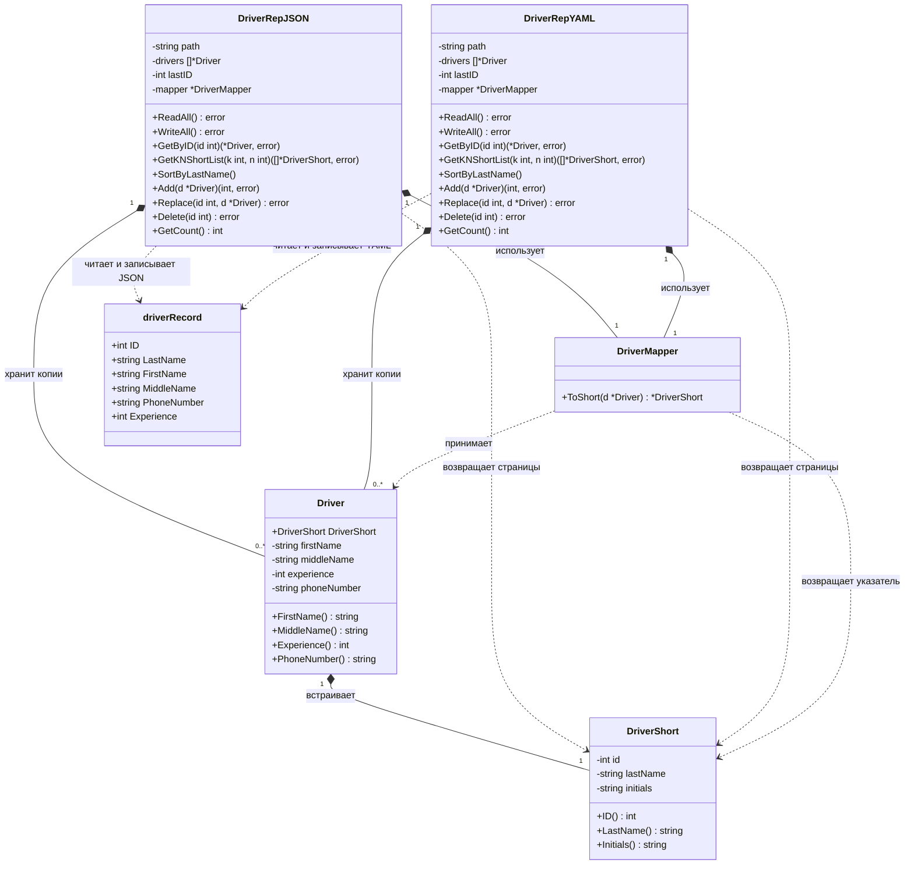

Диаграмма отражает пункты 1 и 2 ЛР2. Методы моделей первой лабораторной
показаны в сокращённом виде; полная диаграмма ЛР1 находится в
[driver_class_diagram.md](driver_class_diagram.md).

`NewDriverRepJSON(path)` и `NewDriverRepYAML(path)` создают пустые репозитории.
Это функции пакета `file`, возвращающие указатель на соответствующий тип
и ошибку. Для загрузки файла нужно вызвать `ReadAll`.

`driverRecord` содержит экспортируемые поля с JSON- и YAML-тегами. Оба
репозитория используют эту структуру из `repository/file/record.go`. При загрузке
каждая запись превращается в `Driver` через конструктор с валидацией.

На этом этапе репозитории являются отдельными типами. Объединение в общую
иерархию относится к пункту 3 ЛР2.

Маппер возвращает указатель на встроенную модель. Репозиторий копирует
полученный `DriverShort`, чтобы изменение результата не затрагивало его список.
