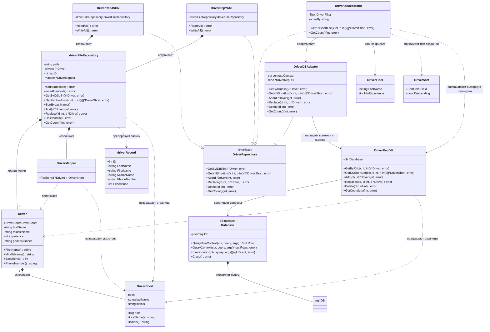

Диаграмма отражает пункты с 1 по 7 ЛР2. Методы моделей первой лабораторной
показаны в сокращённом виде; полная диаграмма ЛР1 находится в
[driver_class_diagram.md](driver_class_diagram.md).

`NewDriverRepJSON(path)` и `NewDriverRepYAML(path)` создают пустые репозитории.
Это функции пакета `file`, возвращающие указатель на соответствующий тип
и ошибку. Для загрузки файла нужно вызвать `ReadAll`.

`DriverRepJSON` и `DriverRepYAML` встраивают `driverFileRepository`. Методы
поиска, сортировки, пагинации и изменения списка определены в общем типе и
доступны у обоих репозиториев. Это аналог наследования поведения через
встраивание в Go. На диаграмме показана композиция.

Общий тип читает и записывает файл. Каждый репозиторий передаёт ему функции
преобразования `driverRecord` в свой формат и обратно. При загрузке общий
тип создаёт `Driver` через конструктор с валидацией.

Маппер возвращает указатель на встроенную модель. Репозиторий копирует
полученный `DriverShort`, чтобы изменение результата не затрагивало его список.

`database.GetDatabase(ctx, dsn)` открывает общий пул PostgreSQL и возвращает
один экземпляр `Database` на процесс. `NewDriverRepDB(db)` принимает этот
экземпляр. Репозиторий составляет SQL и преобразует результаты в модели.
Выполнение запросов он делегирует `Database`.

`DriverRepJSON` и `DriverRepYAML` реализуют `DriverRepository` через методы
встроенного типа. `DriverDBAdapter` реализует тот же интерфейс и передаёт
контекст из конструктора в каждый вызов `DriverRepDB`.

`DriverDBDecorator` оборачивает `DriverDBAdapter` и меняет поведение
`GetKNShortList` и `GetCount`. Остальные вызовы выполняет адаптер.
PostgreSQL применяет фильтр и сортировку перед выбором страницы.
Счётчик использует тот же фильтр.
