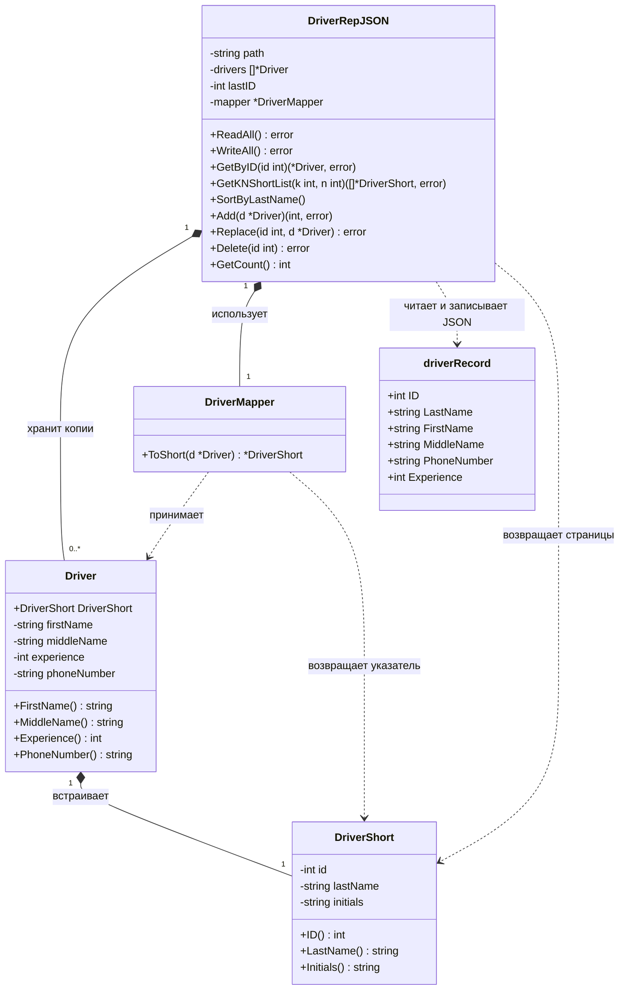

Диаграмма отражает первый пункт ЛР2. Методы моделей первой лабораторной
показаны в сокращённом виде; полная диаграмма ЛР1 находится в
[driver_class_diagram.md](driver_class_diagram.md).

`NewDriverRepJSON(path)` создаёт пустой репозиторий. Это функция пакета
`file`, возвращающая `(*DriverRepJSON, error)`.

`driverRecord` содержит экспортируемые поля с JSON-тегами. При загрузке
каждая запись превращается в `Driver` через конструктор с валидацией.

Маппер возвращает указатель на встроенную модель. Репозиторий копирует
полученный `DriverShort`, чтобы изменение результата не затрагивало его список.
